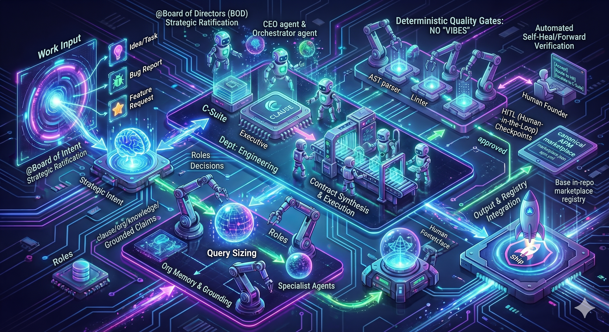

<p align="center">
  
</p>
<div align="center">

# ⚡ ClauseOS (`clause.os`)

**Autonomous, Hermetic Single-Driver OS Environment & Air-Gapped Cloud Bursting Platform**

[](#)
[](#)
[](#)
[](#)
[](#)

<p align="center">
  <a href="#-overview">Overview</a> •
  <a href="#-core-architectural-pillars">Architectural Pillars</a> •
  <a href="#-operating-system-primitives-mapping">OS Primitives</a> •
  <a href="#-canonical-directory-hierarchy">Directory Layout</a> •
  <a href="#-unified-model-cache--ai-storage">AI Storage</a> •
  <a href="#-cross-platform-micro-virtualization-cx-vm">Virtualization</a> •
  <a href="#-autonomous-virtual-enterprise">Virtual Enterprise</a> •
  <a href="#-hardware-acceleration-matrix">Hardware Matrix</a> •
  <a href="#-quick-start">Quick Start</a> •
  <a href="#-open-core--monetization-strategy">Strategy</a> •
  <a href="#-architecture-decision-records">ADRs</a>
</p>

</div>

---

## 🧭 Overview

**ClauseOS** is a bare-metal, self-contained operating system environment architecture designed to execute directly on the host machine while operating entirely within a hermetically confined profile directory (`.home/`). By redirecting `$HOME`, `$USERPROFILE`, and standard OS directory structures strictly into this localized root, ClauseOS eliminates host-level package managers, path pollution, global registry tampering, and configuration drift.

ClauseOS functions as an **Air-Gapped Seed Node**: a mobile command center capable of operating completely offline, self-bootstrapping isolated developer toolchains and specialized neural runtimes, bursting infrastructure into remote clouds via Pulumi, and cleanly detaching while cloud clusters continue autonomous operations.

Unlike virtual machines or Docker containers, ClauseOS introduces **zero hypervisor overhead** for local tools and grants applications unhindered, direct bare-metal access to hardware acceleration pipelines (NVIDIA CUDA, AMD ROCm, Intel XPU, and Apple Silicon MPS).

---

## 🏛️ Core Architectural Pillars

### 1. 🛡️ True Bare-Metal Hermetic Confinement
* **Immutable State Root (`.home/`):** All configurations, state stores, caches, models, and application data reside inside `CLAUSE_PROJECT_ROOT/.home`.
* **Zero Global Pollution:** Deleting `.home/` completely resets the environment to a pristine state without leaving residual files, PATH edits, or registry entries on the host machine.
* **Automated Hermeticity Assertions:** Continuous CI/CD testing (`tests/system/test_hermeticity.nu`) guarantees zero host path leakage or shell delimiter bleeding.

### 2. ⚙️ Two-Tier Orchestration Model (`mise` + `renv`)
* **Stage 1 & 2 (Base Tools & Cluster Engines):** Managed via `mise` (`.mise.toml`), provisioning core developer runtimes (`uv`, `just`, `git`, `nu`, `pulumi`) alongside HashiStack orchestrators (`nomad`, `consul`, `vault`).
* **Stage 3 (`renv` Application Layer):** Custom, isolated runtime environments provisioned on-demand via standalone `uv` into dedicated virtual environments (`apps/<name>/venv`), each with an independent CPython installation and zero cross-package contamination.

### 3. 🧠 Unified Ecosystem Model Storage (`HF_HOME`)
* Consolidates all AI checkpoints, LoRAs, UNet backbones, and GGUF quantizations into a single shared root (`.home/.local/share/models`).
* Automatically maps ComfyUI via `extra_model_paths.yaml` directly to the shared Hugging Face cache, eliminating redundant multi-gigabyte weight downloads between Unsloth, ComfyUI, Lemonade, and FastFlowLM.

### 4. 📦 Cross-Platform Micro-Virtualization (`cx vm`)
* Unified, disposable micro-instance engine running Linux-exclusive workloads (e.g., bare-metal Kubernetes/k3s, systemd daemons, eBPF probes) without privileged host daemons.
* Dynamically dispatches to **WSL2** on Windows (rootfs tarball imports confined to `.home/`) and **Lima (`limactl`)** on macOS/Linux with native multi-distro support (Alpine, Ubuntu, Debian).

### 5. 🤖 Autonomous Virtual Enterprise
* Built-in multi-agent corporate hierarchy (Board of Directors, Executive Leadership, Operational Departments) governed by `constitution.toml`.
* Autonomous agents leverage local neural coprocessors, execute batch tasks via Nomad `raw_exec` with full repo write privileges, and collaborate through an embedded Portable VS Code command harness.

---

## 🧩 Operating System Primitives Mapping

ClauseOS maps userland binaries and services directly into functional OS system primitives:

| OS Primitive | ClauseOS Component | Hermetic Target Location | System Function |
| :--- | :--- | :--- | :--- |
| **Microkernel / Exec** | `boot.ps1` / `cx.*` | `CLAUSE_PROJECT_ROOT/scripts/core/boot.ps1` | Stage 0 bootloader & sandbox barrier enforcement |
| **Shell & Init (PID 1)** | Nushell (`nu`) | `.home/AppData/Local/Programs/bin/nu` or `.home/.local/bin/nu` | Interactive command processor & process supervisor |
| **Driver & HAL** | Mise | `.home/.../bin/mise` | Unified toolchain driver & dynamic runtime manager |
| **Task Scheduler** | Just | `.home/.../bin/just` | Task runner for system workflows & operational recipes |
| **Private Python Driver** | `uv` (Astral) | `.home/.../bin/uv` | Hermetic virtual environment & wheel resolution engine |
| **Micro-Hypervisor** | `cx vm` (WSL2 / Lima) | `.home/.../vms/` | Disposable Linux micro-instances for k3s & Linux-only daemons |
| **AI Fine-Tuning Engine**| Unsloth | `.home/.../apps/unsloth/` | Hardware-accelerated LLM parameter-efficient training |
| **Neural Studio** | ComfyUI | `.home/.../apps/comfyui/` | Node-based diffusion model inference & visual studio |
| **Neural Coprocessors** | Lemonade / FastFlowLM | `.home/.../apps/lemonade/` | Embedded local LLM inference daemons & background agents |
| **Window Manager / UI** | Portable VS Code | `.home/.../apps/vscode/` | Primary graphical cockpit & agent host harness |
| **Concurrency Engine** | Erlang (BEAM) / Gleam | `.home/.../mise/installs/erlang` | Fault-tolerant distributed actor subsystem |
| **Infra Kernel** | Pulumi CLI | `.home/.../apps/pulumi/` | Multi-cloud resource orchestration & state engine |
| **Workload Scheduler** | HashiCorp Nomad | `.home/.../bin/nomad` | Distributed job & container orchestrator (`raw_exec`) |
| **Service Registry** | HashiCorp Consul | `.home/.../bin/consul` | Service discovery, mesh DNS, & Raft consensus |
| **Secrets Engine** | HashiCorp Vault | `.home/.../bin/vault` | Cryptographic key storage, leases, & identity management |

---

## 📂 Canonical Directory Hierarchy

ClauseOS maps platform-specific conventions directly into the `.home/` sandbox:

```text
CLAUSE_PROJECT_ROOT/
├── .enterprise/                          # Virtual Enterprise Configuration Root
│   ├── board/                            # Board of Directors & constraints (constitution.toml)
│   ├── executive/                        # C-Suite agent schemas (CEO, CTO, CPO)
│   ├── departments/                      # Operational departments (Engineering, Security, SRE, QA)
│   ├── skills/                           # Modular CLI skills & toolsets (git-ops, test-runner)
│   └── plugins/                          # Dynamic reasoning extensions for agent harness
├── .home/                                # Hermetic Root ($HOME & $USERPROFILE)
│   ├── AppData/Local/Programs/           # [Windows] Binaries, apps, and logs
│   │   ├── bin/                          # Unified Stage 0/1 binaries & Mise shims
│   │   ├── apps/                         # Standalone 'renv' deployments (unsloth, comfyui, vscode)
│   │   ├── vms/                          # Confined WSL2 Virtual Hard Disks (ext4.vhdx)
│   │   └── logs/                         # Bootstrap & system execution logs
│   ├── .local/                           # [POSIX] Linux / macOS Application & Binary Root
│   │   ├── bin/                          # Unified binaries & shims
│   │   ├── apps/                         # Standalone 'renv' applications
│   │   ├── share/                        # Persistent application data (Mise, Nomad, Consul, Vault)
│   │   │   ├── models/                   # Unified Model Hub ($HF_HOME)
│   │   │   │   ├── hub/                  # Shared Hugging Face weights, LoRAs, and checkpoints
│   │   │   │   └── torch/                # Torch hub cache
│   │   │   └── vms/                      # Confined Lima micro-instances ($LIMA_HOME)
│   │   └── logs/                         # Bootstrap & execution logs
│   ├── .config/                          # [POSIX] XDG Config Home (Mise config, etc.)
│   ├── .cache/                           # Cache root (uv cache, vms/images rootfs cache)
│   └── .gitconfig                        # Isolated Git user identity file
├── docs/
│   └── adr/                              # Architecture Decision Records (ADRs)
├── ops/                                  # Infrastructure as Code & Orchestration
│   ├── config/                           # Nomad, Consul, and Vault HCL configs
│   ├── jobs/                             # Nomad job definitions (agent workers, batch runs)
│   └── stacks/                           # Pulumi Cloud Infrastructure definitions
├── packages/                             # Custom internal packages & language extensions
├── projects/                             # User projects & workspace repositories
├── scripts/
│   ├── cli/
│   │   ├── nu/                           # Nushell modules (vm.nu, coprocessor.nu, config.nu)
│   │   └── pwsh/
│   │       ├── installers/               # Stage 1 pre-Mise bootstrap installers
│   │       └── renv/                     # Stage 3 post-Mise runtime environment recipes
│   └── core/
│       └── boot.ps1                      # Microkernel boot engine
├── tests/
│   └── system/                           # Automated hermeticity and stage verification suites
├── .clause.toml                          # Central OS manifest & application toggle declarations
├── .mise.toml                            # Toolchain dependency & version manifest
├── justfile                              # Operational task commands
├── cx.bat                                # Windows Entrypoint Trampoline
├── cx.ps1                                # PowerShell Entrypoint Trampoline
└── cx.sh                                 # POSIX (Linux/macOS) Entrypoint Trampoline
```

---

## 🧠 Unified Model Cache & AI Storage

All AI workloads share a single, zero-duplication model cache rooted in `$HF_HOME`:

```text
.home/.local/share/models/
├── hub/
│   ├── models--unsloth--Qwen2.5-Coder-7B-Instruct/   ◄── Shared by Unsloth & Coprocessor
│   ├── models--black-forest-labs--FLUX.1-schnell/    ◄── Read by ComfyUI via extra_model_paths.yaml
│   └── models--bartowski--Llama-3.2-3B-GGUF/         ◄── FastFlowLM / Lemonade Agent Daemon
└── torch/                                             ◄── Torchvision & Torch Hub weights
```

* **Zero Duplication:** Unsloth fine-tunes weights directly against the same Hugging Face cache that ComfyUI queries for image generation and the agent daemons read for inference.
* **Hermetic Portability:** Backing up or moving `.home/.local/share/models` preserves the complete weights library without touching host OS directories.

---

## 📦 Cross-Platform Micro-Virtualization (`cx vm`)

For services requiring a full Linux kernel (such as lightweight Kubernetes via `k3s`, systemd services, or container daemons), ClauseOS exposes the unified `cx vm` subsystem:

```text
                               ┌─────────────────┐
                               │     cx vm       │
                               └────────┬────────┘
                                        │
                 ┌──────────────────────┴──────────────────────┐
                 ▼                                             ▼
         [Host == Windows]                             [Host == macOS / Linux]
                 │                                             │
          WSL2 Driver                                     Lima Driver
       (wsl.exe --import)                              (limactl start)
                 │                                             │
    Confined: .home/.../vms/                      Confined: $LIMA_HOME (.home/.../vms/)
  Distros: Alpine, Ubuntu, Debian               Distros: Alpine, Ubuntu, Debian
```

```nushell
# Launch a featherweight Alpine instance in ~1 second
cx vm launch k3s-node --distro alpine

# Execute commands directly inside the micro-instance
cx vm exec k3s-node -- uname -a

# Open an interactive shell
cx vm shell k3s-node

# Cleanly purge the VM and wipe all state
cx vm purge k3s-node
```

---

## 🤖 Autonomous Virtual Enterprise

ClauseOS includes an enterprise agent harness designed to run autonomous developer and operational teams directly inside the workspace:

```text
.enterprise/
├── board/                              # Governance & constraints (constitution.toml)
├── executive/
│   ├── ceo_agent                       # Strategic roadmap & issue dispatching
│   ├── cto_agent                       # Architectural integrity, ADR enforcement, code audits
│   └── cpo_agent                       # Feature delivery & developer UX tracking
├── departments/
│   ├── engineering/                    # Full repo write access (feature branches, test suites)
│   ├── security_audit/                 # Static analysis, dependency audits, secret scanning
│   ├── site_reliability/              # Nomad workload monitoring & Consul mesh health
│   └── documentation_qa/               # ADR authoring & documentation sync
└── skills/                             # Modular CLI toolsets (git-ops, test-runner, adr-writer)
```

* **Write-Access Guardrails:** Agents run via Nomad `raw_exec` tasks with credentials leased through Vault. Code modifications occur on isolated feature branches and require green passes from `just test-hermeticity` before pull requests are finalized.
* **Portable Cockpit:** Portable VS Code runs natively within the profile, bound directly to the local coprocessor (`http://127.0.0.1:8000/v1`) for local code intelligence.

---

## ⚡ Hardware Acceleration Matrix

ClauseOS dynamically queries the host hardware at runtime to resolve and inject the correct binary index without requiring host driver installations:

```text
                                [ Hardware Probing Subsystem ]
                                               │
             ┌─────────────────────────────────┼─────────────────────────────────┐
             ▼                                 ▼                                 ▼
        [ Windows ]                        [ Linux ]                         [ macOS ]
             │                                 │                                 │
     ┌───────┴───────┐                 ┌───────┴───────┐                 ┌───────┴───────┐
     ▼               ▼                 ▼               ▼                 ▼               ▼
  NVIDIA            AMD             NVIDIA            AMD             Apple Silicon    Intel
(CUDA 12/13)    (ROCm 10.0)      (CUDA 12/13)     (ROCm 7.2)         (Native MPS)   (CPU Fallback)
```

* **NVIDIA CUDA:** Probes driver version via `nvidia-smi` and maps to `cu124`, `cu126`, `cu128`, or `cu130`.
* **AMD ROCm (Linux):** Probes `/dev/kfd` and `rocminfo`, targeting `https://download.pytorch.org/whl/rocm7.2`.
* **AMD ROCm (Windows):** Queries `Win32_VideoController` and configures AMD multi-architecture wheels (`torch[device-all]==2.13.0+rocm10.0.0`).
* **Intel Arc (XPU):** Detects Arc GPUs and binds `https://download.pytorch.org/whl/xpu`.
* **Apple Silicon (macOS `arm64`):** Leverages native Apple Metal Performance Shaders (`mps`).
* **macOS Intel (`x86_64`):** Gracefully falls back to CPU execution and automatically filters out unsupported architecture wheels (e.g. `comfy-angle`) to avoid dependency resolution errors.

---

## 🚀 Quick Start

### 1. Launch the Microkernel Bootloader

Run the unified `cx` command for your platform. This provisions Stage 0 tools, initializes directory anchors, configures `.home/`, syncs `.mise.toml`, runs active `renv` recipes, and drops you into the hermetic Nushell environment:

**Windows (CMD / PowerShell):**
```cmd
cx
```

**Linux / macOS (POSIX Shell):**
```bash
./cx.sh
```

### 2. Verify State Hermeticity

Once inside the ClauseOS Nushell session, verify that your environment is completely confined to `.home/`:

```nushell
just test-hermeticity
```

### 3. Launch Orchestration & AI Workloads

```nushell
# Start local HashiCorp Nomad dev cluster
nomad agent -dev -config ops/config/nomad.hcl

# Launch local Neural Coprocessor Daemon
coprocessor start --engine lemonade --port 8000

# Launch ComfyUI Studio
comfyui --listen 127.0.0.1 --port 8188

# Launch Unsloth Fine-Tuning CLI
unsloth --help
```

---

## ☁️ Cloud Bursting & Detachment Flow

ClauseOS acts as an air-gapped seed node. It provisions remote cloud infrastructure (AWS, GCP, Azure, Hetzner, Bare Metal) using embedded Pulumi and HashiStack primitives, promotes remote nodes to quorum, and detaches cleanly:

```nushell
# 1. Burst local workspace state to cloud infrastructure
clause cloud up

# 2. Verify remote Nomad & Consul cluster consensus
clause cluster status

# 3. Sever local connection (Local node drains; Cloud cluster continues autonomous execution)
clause cloud detach
```

---

## 💼 Open-Core & Monetization Strategy

ClauseOS strictly adheres to an unconstrained, developer-first open-core model:

* **Open-Source Base Substrate (100% Free & Unrestricted):**
  * Complete hermetic single-driver OS environment (`.home/` confinement).
  * Unlimited local node orchestration, clustering (Nomad/Consul/Vault), and cloud bursting via Pulumi.
  * Dynamic 5-way GPU auto-detection and cross-platform virtualization (`cx vm`).
  * Base Virtual Enterprise agent harness, skill runner, and portable editor cockpit.
* **Commercial Tier (Industry Adaptation & Enterprise Blueprints):**
  * **Regulated Industry Packs:** Pre-configured Virtual Enterprise cartridges for HIPAA Healthcare, FINRA/SEC FinTech, and Defense air-gapped environments.
  * **Enterprise Compliance & Governance:** Cryptographic audit trails, Open Policy Agent (OPA) agent guardrails, and automated board-level risk controls.
  * **Legacy Enterprise Connectors:** Turnkey bridges to SAP, Oracle, Epic, and corporate identity providers.

---

## 📚 Architecture Decision Records (ADRs)

Key architectural decisions are documented under `docs/adr/`:

* [**ADR 0001**: Hermetic State Confinement and Canonical Directory Hierarchy](docs/adr/0001-hermetic-state-confinement-and-canonical-directory-hierarchy.md)
* [**ADR 0002**: Two-Tier Toolchain Orchestration (`mise` and `renv`)](docs/adr/0002-two-tier-toolchain-orchestration-mise-and-renv.md)
* [**ADR 0003**: Dynamic Multi-Vendor Hardware Acceleration Matrix](docs/adr/0003-dynamic-multi-vendor-hardware-acceleration-matrix.md)
* [**ADR 0004**: Cross-Shell Environment and PATH Delimiter Canonicalization](docs/adr/0004-cross-shell-environment-and-path-delimiter-canonicalization.md)
* [**ADR 0005**: Unified Model Storage & Ecosystem Cache Projection](docs/adr/0005-unified-model-storage-hub.md)
* [**ADR 0006**: Cross-Platform Micro-Instance Virtualization (`cx vm`)](docs/adr/0006-micro-instance-virtualization.md)
* [**ADR 0007**: Open-Core Substrate vs. Industry Adaptation Commercialization](docs/adr/0007-open-core-and-monetization.md)
* [**ADR 0008**: Virtual Enterprise Organizational Hierarchy & Agent Governance](docs/adr/0008-virtual-enterprise-agent-hierarchy.md)
* [**ADR 0009**: VS Code Agent Host, Extensibility Plugins, and Skill Toolsets](docs/adr/0009-agent-skills-plugins-vscode-harness.md)

---

<div align="center">

Built With ❤️ By Vieo

</div>